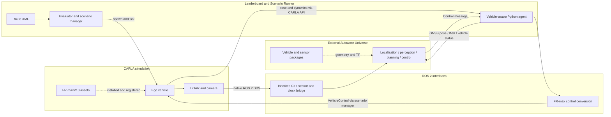

# Yuhesen FR-max Autonomous Driving Simulation

**CARLA 0.9.16 target · Autoware Universe integration · ROS 2 Humble · Ackermann robotics**

Adapting an autonomous-driving simulation framework to a compact Ackermann-steered robot requires more than selecting a new mesh. Vehicle geometry, steering commands, acceleration control, sensor placement, ROS interfaces, and scenario configuration must describe the same platform.

This project brings those integration layers together for the **Yuhesen FR-max**, extending the [TUM Autoware CARLA Leaderboard framework](https://github.com/TUMFTM/autoware_carla_leaderboard). My work focuses on platform-specific agent adaptations, control conversion, vehicle and sensor configuration, CARLA asset integration, and cyclist-following route design across three repositories.

## Engineering highlights

- **Vehicle-aware agents:** detect the spawned actor type and select FR-max control and sensor configurations while retaining the inherited Audi configuration.
- **Robot-specific control conversion:** map ±25° tire-angle commands to CARLA steering, with FR-max acceleration-feedback gains and throttle/brake limits.
- **Autoware platform configuration:** provide a 0.85 m wheelbase, 0.436 rad steering limit, vehicle visualization, sensor extrinsics, and LiDAR preprocessing launch configuration.
- **Scenario development:** add three cyclist-following route definitions across Town01 and Town10HD, including a Town01 variant with background-traffic parameters.
- **System integration:** connect Python agents, the inherited ROS 2 C++ bridge, Autoware packages, and Unreal vehicle assets through documented interfaces.

The delivered artifacts establish the integration design and implementation. End-to-end FR-max and cyclist execution requires the dependency adaptations described in [Getting started](docs/SETUP.md#execution-prerequisites); successful scenario completion and performance measurements are not yet documented.

## System demonstration

The source and configuration are the current portfolio evidence. No CARLA/RViz screenshots or simulation recordings were found in these three repositories. Media in the neighboring cyclist-follower project concerns a separate robot pipeline and is not presented as a demonstration of this simulation.

For a reproducible demonstration, capture the FR-max actor ID and model in CARLA, the matching vehicle/TF/point clouds in RViz, a cyclist-following segment, and its exact dependency commits and result JSON. See the [capture checklist](docs/SIMULATION_SCENARIOS.md#demonstration-capture-checklist).

## System architecture

Dashed connections require installation or configuration outside this repository. The declared Leaderboard branch currently spawns an Audi; the FR-max asset-to-ego connection requires an adapted spawning dependency. [Detailed architecture and topic contracts →](docs/ARCHITECTURE.md)

## My engineering contributions

| Area | My implementation or integration work | Engineering significance |
|---|---|---|
| CARLA vehicle integration | [Actor-type selection in the E2E agent](src/tum_agents/autoware_agent/aw_e2e.py) and [FR-max assets](https://github.com/gokcerSnmzck/carla_fr_maxv10) | Connect a custom platform identity to agent configuration; asset registration and spawning remain deployment prerequisites. |
| Autoware platform adaptation | [Vehicle and sensor packages](https://github.com/gokcerSnmzck/carla_yuhesen_fr_max) | Express the robot footprint, kinematics, visualization, and sensor transforms in Autoware's package structure. |
| Control and kinematics | [Vehicle-specific converter](src/tum_agents/autoware_agent/aw_converter.py) | Replace the passenger-car steering map and acceleration-loop parameters with a compact-robot configuration. |
| Sensor and ROS 2 integration | [E2E](src/tum_agents/autoware_agent/aw_e2e.py) and [privileged](src/tum_agents/autoware_agent/aw_priviliged.py) agent adaptations | Introduce FR-max sensor placement and channel counts; extend Python LiDAR conversion and initialize E2E state before ROS callbacks start. |
| Scenario development | [Three cyclist route definitions](docs/SIMULATION_SCENARIOS.md) | Define repeatable research inputs for following behavior and traffic isolation. |
| Environment integration and validation | [Setup](docs/SETUP.md), [architecture](docs/ARCHITECTURE.md), and [contribution evidence](docs/TECHNICAL_CONTRIBUTIONS.md) | Make cross-repository interfaces and the remaining execution prerequisites explicit and reviewable. |

Git commit [`d3dff21`](https://github.com/gokcerSnmzck/autoware_carla_leaderboard_custom/commit/d3dff21f88d56c974c19b81529940014348abea8) records the main custom implementation. The C++ bridge, clock synchronization, baseline agents, object conversion, and evaluation framework originate upstream. Supporting packages retain TUM/Tier IV attribution; publishing or adapting assets does not establish original 3D-model authorship. [Contribution boundaries →](docs/TECHNICAL_CONTRIBUTIONS.md)

## Engineering challenges and solutions

| Challenge | Approach and implemented result |
|---|---|
| Passenger-car steering assumptions | Added an FR-max branch with a ±25° map, radians-to-degrees conversion, sign inversion, and normalized CARLA output. |
| Different longitudinal response | Added acceleration-feedback gains `Kp=0.25`, `Ki=0.05`, `Kd=0`, throttle cap `0.4`, and brake cap `0.3`; closed-loop quality still requires measurement. |
| Compact robot sensor layout | Added lower-mounted front/rear LiDAR, GNSS, IMU, and camera definitions, plus matching platform configuration artifacts. Cross-frame alignment requires runtime verification. |
| Callback initialization order | Moved E2E callback state initialization ahead of subscriptions and the ROS spin thread. This addresses the ordering hazard in source; no stress-test claim is made. |

[Implementation details →](docs/ENGINEERING_CHALLENGES.md)

## Simulation scenarios

| Route | Research objective | Configured lead actor and values |
|---|---|---|
| [Town01 approach](resources/routes/town01_cyclist_follower.xml) | Approach with a turn before the following straight | Diamondback bicycle; distance `15`, velocity `5` |
| [Town01 straight, v2](resources/routes/town01_cyclist_follower_v2.xml) | Isolate following on a straight with background-traffic controls | Diamondback bicycle; distance `10`, velocity `5` |
| [Town10HD straight](resources/routes/town10_follow_cyclist.xml) | Transfer the experiment to another town | Diamondback bicycle; distance `10`, velocity `5` |

These are authored scenario inputs. The declared Scenario Runner version does not consume their bicycle/distance/velocity parameters; runtime cyclist behavior requires an adapted scenario implementation. [Triggers, waypoints, and execution semantics →](docs/SIMULATION_SCENARIOS.md)

## Technology stack

**Directly adapted/configured:** Python, ROS 2 interfaces, Ackermann control conversion, Autoware vehicle/sensor YAML and Xacro, scenario XML, and CARLA vehicle asset deployment.

**Integrated dependencies:** C++ ROS 2 bridge; CARLA native ROS 2 DDS; Autoware Universe localization, perception, planning and control; CARLA Leaderboard; Scenario Runner; Unreal Engine assets; Docker on ROS 2 Humble/Ubuntu 22.04.

`docker/requirements.txt` pins the CARLA Python client to **0.9.16**; `docker/Dockerfile` selects **ROS 2 Humble**. The exact Autoware Universe release is not pinned, so the previous blanket “1.7.1 compatible” statement is not treated as verified. [Compatibility and setup →](docs/SETUP.md)

## Getting started

Use the [complete setup guide](docs/SETUP.md) to obtain all three repositories, retrieve Git LFS assets, build the ROS 2 overlay, install the model, verify dependencies, and launch the bridge, Autoware, and evaluation in separate terminals. Commands use environment variables for local paths.

## Related repositories

- [carla_yuhesen_fr_max](https://github.com/gokcerSnmzck/carla_yuhesen_fr_max): five ROS 2 packages for vehicle description, sensor description, and launch integration.
- [carla_fr_maxv10](https://github.com/gokcerSnmzck/carla_fr_maxv10): Git LFS-managed CARLA Blueprint, wheel, mesh/skeleton, physics, animation, and material assets.

## Author and attribution

**Gökcer Sönmezocak** · M.Eng. Embedded Systems Engineering

FH Dortmund — University of Applied Sciences and Arts

Technical interests: Autonomous Systems, Robotics Software, Embedded Systems, ROS 2, Computer Vision and Simulation.

Built on [TUM AWCL](https://github.com/TUMFTM/autoware_carla_leaderboard), [CARLA](https://github.com/carla-simulator/carla), [Autoware](https://github.com/autowarefoundation/autoware), and their dependencies. Preserve source notices and [LGPLv3 licensing](LICENSE.md); Tier IV files retain their Apache-2.0 notices. This is research simulation software; simulation configurations and gains do not establish hardware safety or real-robot readiness.
