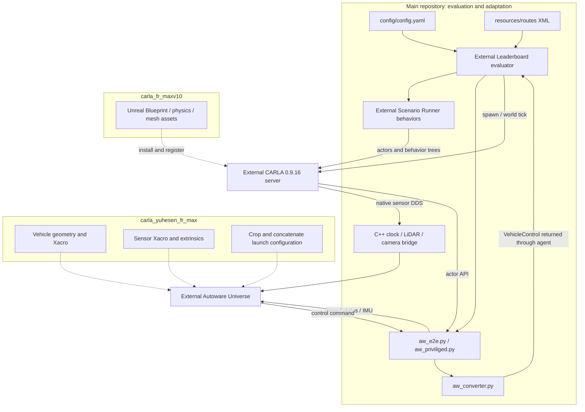
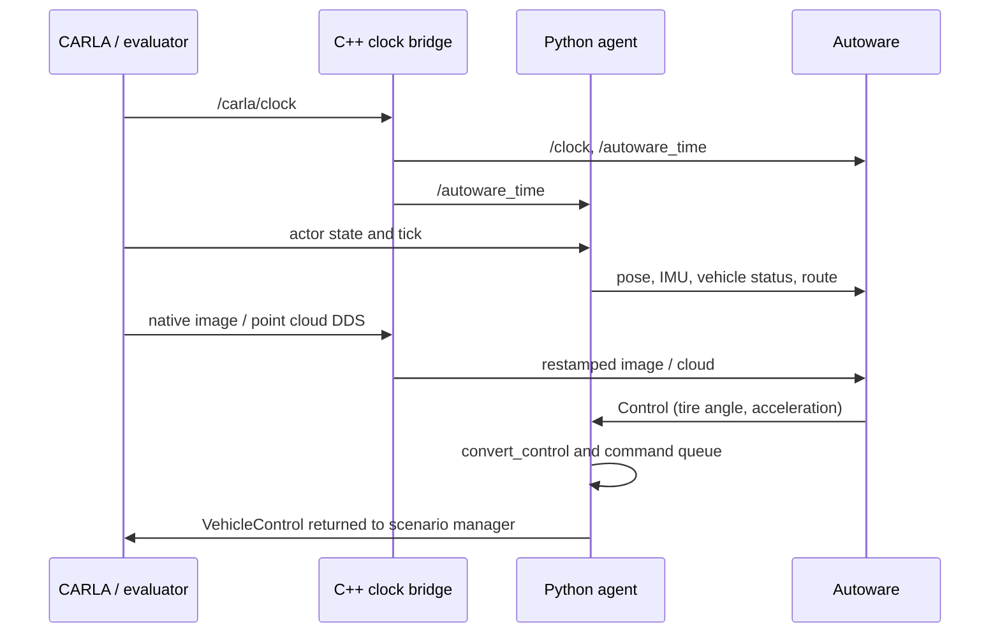

# Integration architecture

The project extends TUM AWCL through platform-specific Python agent and configuration changes. CARLA assets and Autoware descriptions live in separate repositories and are installed into different environments.

## Repository boundaries

The dashed arrows denote installation or launch integration, not a proven runtime connection. Autoware and the CARLA server are external installations; neither is built by cloning this repository. `docker/carla.repos` imports the TUM Leaderboard and Scenario Runner forks; `docker/ros2.repos` imports message packages for the bridge, not the complete Autoware stack.

## Execution and ego selection

The evaluator loads YAML with `--conf_file_path`, imports the configured Python agent, and uses the route indexer to select the route XML/subset and repetitions. The external route scenario creates the ego at the first interpolated waypoint, and Scenario Runner manages scenario triggers and behaviors. Its scenario manager applies the `VehicleControl` returned by the agent.

At inspected Leaderboard commit [`029b65d`](https://github.com/TUMFTM/leaderboard/blob/029b65d42d26d4e029c15b97335b9d0f918e5766/leaderboard/scenarios/route_scenario.py), `_spawn_ego_vehicle()` requests `vehicle.audi.etron` with role `hero`. No `ego_vehicle_model` consumer was found in the inspected Leaderboard Python source. Consequently `ego_vehicle_model: fr-maxv10` in this repository cannot select the robot with that dependency revision. A locally adapted Leaderboard is required; its patch is not present in these repositories.

Agent `setup()` retrieves the hero actor, stores its actual `type_id`, and passes it to `AutowareConverter`. The FR-max branch is selected by the substring `fr-max`. This mechanism works only after a matching actor has actually been spawned. Exact runtime blueprint identity must be queried from the installed server; an asset filename or YAML label is insufficient evidence.

## Sensor and ROS 2 contracts

| Producer and path | Output / consumer | Source-level behavior |
|---|---|---|
| E2E CARLA LiDAR specs `sensor/lidar/front`, `sensor/lidar/back` | C++ inputs `/carla/ego_vehicle/sensor/lidar/front/point_cloud`, `/carla/ego_vehicle/sensor/lidar/back/point_cloud` | Native CARLA DDS is the active E2E image/cloud path. Verify the actual actor ROS namespace; ego role is `hero`, while bridge inputs expect `ego_vehicle`. |
| C++ LiDAR nodes | `/sensor/lidar/front`, `/sensor/lidar/rear` | Rebuild PointCloud2 fields, synthesize channel/return metadata, assign `lidar_front`/`lidar_rear`, and stamp with Autoware time. Channel IDs are synthesized, not measured rings. |
| C++ camera node | `/sensing/camera/traffic_light/image_raw`, `/sensing/camera/traffic_light/camera_info` | Restamp images and generate pinhole camera information for 800×400, 90° FOV. |
| Python E2E `run_step()` | `/sensing/gnss/pose_with_covariance`, `/sensing/imu/imu_data`, vehicle status topics | Build pose, angular velocity and acceleration from CARLA actor state. These are simulator-derived feedback, not proof of raw GNSS/IMU processing. |
| Python routing logic | `/api/routing/change_route_points`, `/autoware/engage` | Submit route points and engagement requests using inherited mechanisms. |
| Autoware control | `/control/trajectory_follower/control_cmd` → Python callback | Filter timestamps, convert control, enqueue one command for `run_step()`. |
| Autoware acceleration | `/localization/acceleration` → converter | Feedback for the acceleration-error control loop. |

The E2E Python image/LiDAR publication loop is commented out. The privileged agent instead actively converts Python LiDAR arrays; its current loop publishes only the front cloud. Its ground-truth object prediction and localization are inherited. “E2E” here is the framework's agent mode name, not a claim of a learned end-to-end driving system or fully sensor-derived localization.

## Timing and control

The inherited clock bridge accumulates CARLA time deltas; on a reset it advances by one second and enters synchronization mode. During synchronization, wall timers advance Autoware time and replay cached feedback/clouds with updated stamps. A control message clears synchronization mode. Readiness diagnostics are collected, but the all-ready condition currently only clears the readiness set; it is not a complete execution barrier. These are source mechanisms, not measured timing guarantees.

`convert_control()` converts radians to degrees, interpolates steering against the selected table, reverses sign for CARLA, and computes throttle/brake from target minus measured acceleration. FR-max parameters are detailed in [Engineering challenges](ENGINEERING_CHALLENGES.md).

## Autoware support and alignment

The supporting vehicle package specifies a rear-axle `base_link`, 0.85 m wheelbase, 0.645 m tread, and 0.436 rad maximum steering. The sensor kit is offset +0.425 m from `base_link`; individual sensor calibration offsets are relative to that kit. Launch configuration composes vehicle/mirror crop filters and cloud concatenation with vehicle velocity for time compensation. This is configuration of external Autoware components, not a new perception algorithm.

Remaining runtime checks are concentrated in [Setup](SETUP.md#execution-prerequisites): dependency spawning/actor parameters, topic namespaces, channel counts, TF origins, camera resolution, launch arguments and Autoware package/plugin compatibility. The architecture describes the implemented interfaces while preserving those deployment conditions.
